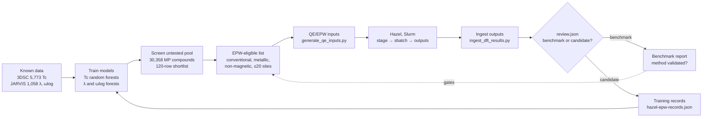

# The RT-SuperConductor loop: where we are and where results go

**Main idea:** the project is one loop. Machine learning ranks materials, Quantum ESPRESSO and EPW on Hazel check the best ones, and reviewed results go back into training so the next ranking is better. As of 2026-11-06, every step exists in code. The only missing piece is the Hazel runs themselves, which wait on cluster access.

> **Update 2026-11-11.** Four things changed; the table and gap list below are annotated where they apply.
>
> 1. **The strict candidate lists are empty, for a data reason.** Since 2026-11-09 the pool builder requires a density-of-states curve for every candidate, and Materials Project's public bucket returned none of the 149 requested (details in `docs/actions-parameters.md`). No candidate was compared with the threshold. So that the loop still names a next candidate, `score_pool_physics.py` now scores the first list that has rows: the strict EPW list, the pool shortlist, then the classifier's ranking `docs/mp-sc-classifier-top200.csv`. Classifier rows keep the classifier's order. The earlier 120-row output is kept as `docs/epw-next-candidates-provisional-20261109.csv`.
> 2. **λ is now fitted in log space** in `train_physics_targets.py`, as ωlog already was. On held-out element systems the Tc error falls from 5.95 K to 2.71 K (guessing the median: 2.99 K). The direct fit stays in the report as a comparison column.
> 3. **The classifier has a workflow.** `.github/workflows/sc-classifier.yml` rebuilds labels and retrains when a label file changes. Before this it ran in no workflow, and its label build looked for the raw tables in a folder layout that CI does not have.
> 4. **Quantum ESPRESSO 7.6 from conda-forge includes `epw.x` and Wannier90, and Stage 0 has been rehearsed with it** (`docs/hazel-runbook.md`, sections 4 to 6).
>
> **Cuprate track (added 2026-11-11).** EPW cannot check cuprates, whose mechanism is unsolved. `docs/cuprate-track.md` describes a separate track that builds the empirical rules for cuprates (doping dome, CuO₂ layer count, apical-oxygen distance, disorder) into 20 features and tests them on unseen cuprate families. The features give a small, consistent gain; nothing from that track changes the ranking yet.



Benchmarks and candidates go to different places on purpose. A benchmark like tantalum checks the **method**, so its result is compared with the published value and never added to training. A candidate is new information, so once a person has reviewed it, it becomes a training row.

## Status of each step

| Step | Script or place | Status | Evidence |
| --- | --- | --- | --- |
| 1. Load known data | `scripts/download_training_data.py`, `scripts/ingest_3dsc.py` | Working | 5,773 3DSC rows, 1,058 JARVIS rows |
| 2a. Tc models | `scripts/train_pressure_aware.py` | Working, tested strictly | Within-family Spearman 0.52 to 0.64 after the shared-ID embargo |
| 2b. λ and ωlog models | `scripts/train_physics_targets.py` | Working | Now accepts reviewed local records via `--extra-records` |
| 3. Screen untested pool | `scripts/build_untested_pool.py` | Working, known artifacts | 120 rows; top cuprate hits trace to a suspected CuCrO2 label error and to insulating RBa2Cu3O6 parents |
| 3b. Full MP snapshot and classifier | `scripts/fetch_mp_snapshot.py`, `build_mp_candidates.py`, `train_mp_sc_classifier.py` | Working | All 30,358 stable MP materials saved; classifier AUC 0.80 on held-out element systems; see `docs/materials-project-snapshot.md` |
| 4. EPW-eligible list | Pending (`codex/pool-label-quarantine`) | In progress | Needs the magnetism filter and an oxygen-variant check |
| 5. QE/EPW inputs | `scripts/generate_qe_inputs.py`, `scripts/prepare_*_benchmark.py` | QE fixed; EPW input blocked | EPW input still lacks nbndsub, projections, windows, fine meshes, μ* |
| 6. Run on Hazel | `scripts/hpc/submit_stage0_pb.sh`, `scripts/hpc/stage_inputs.sh`, `scripts/hpc/job.slurm.sh.template` | Access granted 2026-11-09 (`libstudents` project) | Partition and QOS names are now known (`compute` / `normal`). Staff are still working out the QE install and storage, so Stage 0 waits on that |
| 7. Ingest outputs | `scripts/ingest_dft_results.py` | Working on real EPW output | Reads both EPW output styles: the Eliashberg summary (QE test-suite MgB2; λ = 0.8715, ωlog = 61.47 meV) and the a2f block (QE test-suite Pb; `logavg` in rydberg). It previously found nothing in either, or a bogus λ = 100,000 from an "IR basis: Lambda" line |
| 8. Review and promote | `scripts/promote_dft_results.py` + `results/<id>/review.json` | Working | Benchmarks go to a comparison report; accepted candidates become training records; recomputed Tc must match EPW's printed McMillan Tc within 1% |
| 9. Retrain with results | `train_physics_targets.py --extra-records data/training/hazel-epw-records.json` | New | Records reuse the JARVIS format, so features build the same way |
| 10. Physics models score the pool | `scripts/score_pool_physics.py` → `docs/epw-next-candidates.csv`; `.github/workflows/epw-loop.yml` reruns it | Working | Refits on JARVIS plus reviewed Hazel records and ranks EPW-eligible candidates by agreement between the two models. A test proves a new Hazel record changes the predictions |

## What we will test, in order

| Stage | Material | Role | Compared against | Passes when |
| --- | --- | --- | --- | --- |
| 0 | Pb (official EPW example, in `data/benchmarks/epw-pb-tutorial/`) | Tools check (`role: tools_check`) | EPW's own printed Tc | Every job runs; `promote_dft_results.py` reads λ and ωlog and reproduces EPW's Tc. Submit with `scripts/hpc/submit_stage0_pb.sh` |
| 1 | Ta (JARVIS JVASP-1014) | Benchmark | λ = 0.7572, ωlog = 164.99 K | Both within the suggested 25% tolerance |
| 2 | Nb3Sn | Benchmark | Measured Tc ≈ 18 K (Matthias et al. 1954) | Allen-Dynes Tc lands near the measured value, with μ* stated |
| 3 | Nb12InSn3 (mp-1221007) | First candidate | Predicted 16.1 ± 5.1 K; nearest measured In0.2Nb3Sn0.8 at 17.8 K | Converged result reviewed, then promoted into training |

Each stage must pass before the next starts. The 25% tolerance is a suggested starting point, not an established standard. Tighten it once Stage 1 shows how close the setup gets.

## Where each result goes

| Result | File | Read by | Used for |
| --- | --- | --- | --- |
| Raw QE/EPW outputs | `results/<id>/*.out` (copied back from Hazel's work area) | `ingest_dft_results.py` | Hashes and completion checks |
| Parsed outputs | `data/processed/dft-results/result-manifest.csv` | Review | Seeing what finished |
| Human review | `results/<id>/review.json` | `promote_dft_results.py` | Approving a run as converged and accepted |
| Benchmark comparison | `data/processed/dft-results/promotion-report.json` | You, faculty, the stage gate | Deciding whether the method can be trusted |
| Candidate training rows | `data/training/hazel-epw-records.json` | `train_physics_targets.py` | Retraining λ and ωlog models |
| Retrained models | `data/processed/physics-target/electron-phonon-target-models.joblib` | Ranking (step 10, once built) | Choosing the next candidates |

The work area on Hazel is wiped after about 30 days untouched and is not backed up. A result exists only once it is copied into `results/<id>/` in the repository.

## How the next candidate is chosen

`scripts/score_pool_physics.py` scores each candidate twice:

- **Physics model:** predicts λ and ωlog from formula features, then turns them into Tc. It is trained on 1,057 JARVIS DFT calculations plus any reviewed Hazel records.
- **Measured-Tc random forest:** the Tc prediction already in the pool file. It is trained on measured Tc values.

The ranking uses the **lower** of the two, so a candidate rises only when both independent models agree it is promising. Candidates are EPW-eligible only if they are in the Other family (not cuprate or iron-based), non-magnetic and at most 20 sites. Magnetism uses Materials Project's `is_magnetic` when the input file has it, and otherwise a heuristic based on Fe, Co, Ni, Mn and Cr.

Held-out quality of the physics model, from 5-fold GroupKFold by elemental system on JARVIS:

| Target | MAE | Median-guess MAE | Spearman |
| --- | --- | --- | --- |
| λ | 0.68 | 0.73 | 0.48 |
| ωlog | 92 K | 115 K | 0.57 |
| Tc (μ* = 0.1) | 2.7 K | 3.0 K | 0.51 |

That is a weak signal on DFT values, and on real outcomes it is about chance: it cannot separate 1,062 known superconductors from 988 tested non-superconductors (AUC 0.53, `docs/mp-physics-ranking.json`). The superconductor classifier trained on labelled MP materials does much better (AUC 0.80) and should choose what EPW checks; see `docs/materials-project-snapshot.md`. On the current 120-row shortlist, the top EPW-eligible candidates are A15-type compounds: Al(V4Si)3 (related to V3Si), Nb12IrAu3, V6GaGe and Al(V4Ge)3.

## A note on the Tc formula

The project's "Allen-Dynes" Tc uses ωlog/1.2 as the prefactor, with no strong-coupling factors. EPW labels this same number its **McMillan expression**, and our formula reproduces EPW's printed value exactly (26.4082 K for MgB2 at μ* = 0.16). EPW's separate "Allen-Dynes modified" line adds strong-coupling factors f1·f2 and comes out about 4% higher in that example. When comparing with papers, check which of the two they report.

## Running one turn of the loop

```bash
# On Hazel's login node: confirm inputs are staged, then submit one step at a time
scripts/hpc/stage_inputs.sh <run_dir> scf ph q2r matdyn nscf epw
sbatch scripts/hpc/<filled-in-job>.sh

# Back in the repository, after copying outputs to results/<id>/ and writing review.json
python scripts/ingest_dft_results.py --results-root results --output data/processed/dft-results/result-manifest.csv
python scripts/promote_dft_results.py --results-root results
python scripts/train_physics_targets.py --extra-records data/training/hazel-epw-records.json
```

## Open gaps, in priority order

1. **Hazel access.** Requested through Research Facilitation; Lib Students project.
2. **The EPW input.** Start from EPW tutorial 04's Pb inputs instead of the generated template.
3. **The parser.** Confirmed on real EPW output from the QE test suite (MgB2). Stage 0 rechecks it on Pb with the EPW version installed on Hazel.
4. **Physics-model quality.** Pool scoring uses formula features only. Its held-out Tc error (2.7 K) only modestly beats guessing the median (3.0 K), with Spearman 0.51. Adding structure features from MP CIFs is the next improvement. `train_physics_targets.py` should also fit log λ, because fitting λ directly doubles its held-out Tc error (5.9 K). *Done 2026-11-11: the trainer fits log λ (2.71 K against 5.95 K on the same folds). The model still does not beat chance on real outcomes, so it stays a second opinion.*
5. **Automation.** Globus Compute could let GitHub Actions submit Hazel jobs. Set it up only after manual runs work (see `docs/hazel-runbook.md`).
6. **The DOS gate decision** (added 2026-11-11). Either keep DOS(E_F) as a required gate, which yields no candidates until the curves can be retrieved, or make it an optional column again. This is a project decision, not a bug fix; `docs/actions-parameters.md` has the evidence.
7. **Stage 1 inputs** (added 2026-11-11). The tantalum EPW input must be written from the Pb example's pattern (Wannier projections, energy windows, band count) and rehearsed the same way Stage 0 was. *Done 2026-11-11: `data/benchmarks/epw-ta-jvasp-1014/` and `scripts/hpc/submit_stage1_ta.sh`. The smoke rehearsal gave λ = 0.778 and ωlog = 159 K against the reference 0.757 and 165 K (`docs/hazel-runbook.md`, section 7). What remains is the full-settings run on Hazel.*
