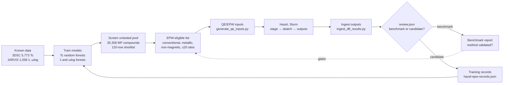

# The RT-SuperConductor loop: where we are and where results go

**Main idea:** the project is one loop. Machine learning ranks materials, Quantum ESPRESSO and EPW on Hazel check the best ones, and reviewed results go back into training so the next ranking is better. As of 2026-11-06, every step exists except two. One is the Hazel runs themselves, which wait on cluster access. The other is that the physics models don't yet score the untested pool.



Benchmarks and candidates go to different places on purpose. A benchmark like tantalum checks the **method**, so its result is compared with the published value and never added to training. A candidate is new information, so once a person has reviewed it, it becomes a training row.

## Status of each step

| Step | Script or place | Status | Evidence |
| --- | --- | --- | --- |
| 1. Load known data | `scripts/download_training_data.py`, `scripts/ingest_3dsc.py` | Working | 5,773 3DSC rows, 1,058 JARVIS rows |
| 2a. Tc models | `scripts/train_pressure_aware.py` | Working, tested strictly | Within-family Spearman 0.52 to 0.64 after the shared-ID embargo |
| 2b. λ and ωlog models | `scripts/train_physics_targets.py` | Working | Now accepts reviewed local records via `--extra-records` |
| 3. Screen untested pool | `scripts/build_untested_pool.py` | Working, known artifacts | 120 rows; top cuprate hits trace to a suspected CuCrO2 label error and to insulating RBa2Cu3O6 parents |
| 4. EPW-eligible list | Pending (`codex/pool-label-quarantine`) | In progress | Needs the magnetism filter and an oxygen-variant check |
| 5. QE/EPW inputs | `scripts/generate_qe_inputs.py`, `scripts/prepare_*_benchmark.py` | QE fixed; EPW input blocked | EPW input still lacks nbndsub, projections, windows, fine meshes, μ* |
| 6. Run on Hazel | `scripts/hpc/stage_inputs.sh`, `scripts/hpc/job.slurm.sh.template` | Waiting on access | Slurm confirmed; partition and QoS names pending |
| 7. Ingest outputs | `scripts/ingest_dft_results.py` | Built, unproven | The λ/ωlog parser has never seen real EPW output; Stage 0 confirms it |
| 8. Review and promote | `scripts/promote_dft_results.py` + `results/<id>/review.json` | New | Benchmarks go to a comparison report; accepted candidates become training records |
| 9. Retrain with results | `train_physics_targets.py --extra-records data/training/hazel-epw-records.json` | New | Records reuse the JARVIS format, so features build the same way |
| 10. Physics models score the pool | Missing | **Gap** | λ/ωlog models only rank prototype substitutions in `run_physics_search.py` today |

## What we will test, in order

| Stage | Material | Role | Compared against | Passes when |
| --- | --- | --- | --- | --- |
| 0 | Pb (EPW tutorial 04) | Tools check | The tutorial's own output | Every program runs, and `promote_dft_results.py` parses λ and ωlog from the real `epw.out` |
| 1 | Ta (JARVIS JVASP-1014) | Benchmark | λ = 0.7572, ωlog = 164.99 K | Both within the suggested 25% tolerance |
| 2 | Nb3Sn | Benchmark | Measured Tc ≈ 18 K (Matthias et al. 1954) | Allen-Dynes Tc lands near the measured value, with μ* stated |
| 3 | Nb12InSn3 (mp-1221007) | First candidate | Predicted 16.1 ± 5.1 K; nearest measured In0.2Nb3Sn0.8 at 17.8 K | Converged result reviewed, then promoted into training |

Each stage must pass before the next starts. The 25% tolerance is a suggested starting point, not an established standard. Tighten it once Stage 1 shows how close the setup gets.

## Where each result goes

| Result | File | Read by | Used for |
| --- | --- | --- | --- |
| Raw QE/EPW outputs | `results/<id>/*.out` (copied back from Hazel's work area) | `ingest_dft_results.py` | Hashes and completion checks |
| Parsed outputs | `data/processed/dft-results/result-manifest.csv` | Review | Seeing what finished |
| Human review | `results/<id>/review.json` | `promote_dft_results.py` | Approving a run as converged and accepted |
| Benchmark comparison | `data/processed/dft-results/promotion-report.json` | You, faculty, the stage gate | Deciding whether the method can be trusted |
| Candidate training rows | `data/training/hazel-epw-records.json` | `train_physics_targets.py` | Retraining λ and ωlog models |
| Retrained models | `data/processed/physics-target/electron-phonon-target-models.joblib` | Ranking (step 10, once built) | Choosing the next candidates |

The work area on Hazel is wiped after about 30 days untouched and is not backed up. A result exists only once it is copied into `results/<id>/` in the repository.

## Running one turn of the loop

```bash
# On Hazel's login node: confirm inputs are staged, then submit one step at a time
scripts/hpc/stage_inputs.sh <run_dir> scf ph q2r matdyn nscf epw
sbatch scripts/hpc/<filled-in-job>.sh

# Back in the repository, after copying outputs to results/<id>/ and writing review.json
python scripts/ingest_dft_results.py --results-root results --output data/processed/dft-results/result-manifest.csv
python scripts/promote_dft_results.py --results-root results
python scripts/train_physics_targets.py --extra-records data/training/hazel-epw-records.json
```

## Open gaps, in priority order

1. **Hazel access.** Requested through Research Facilitation; Lib Students project.
2. **The EPW input.** Start from EPW tutorial 04's Pb inputs instead of the generated template.
3. **The parser.** Confirm `promote_dft_results.py` reads λ and ωlog from Stage 0's real `epw.out`, and fix the pattern if not.
4. **Physics models scoring the pool (step 10).** Score the EPW-eligible list with the retrained λ and ωlog models, so new results change the next choice.
5. **Automation.** Globus Compute could let GitHub Actions submit Hazel jobs. Set it up only after manual runs work (see `docs/hazel-runbook.md`).
